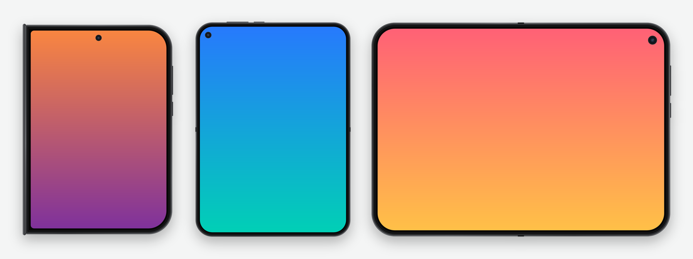

# Xiaomi 18 Fold Screen Frame · 小米 18 Fold 带壳截图

[English](#english) · [中文](#中文)



---

## English

Put your Xiaomi 18 Fold screenshots inside a realistic device frame, from either the inner or the cover screen, in portrait or landscape, in any of the four colors. HyperOS has nothing built in for this, so this small native Android app does it: pick a screenshot or share one in, adjust the look with a live preview, then save or share it at full resolution.

### Features

- **Knows which screen and pose a screenshot came from.** Inner screen (1672×2364) or cover screen (1168×1712), portrait or landscape. It also tells whether the phone was held upside down by checking which side of the status bar leaves room for the punch-hole camera.
- **Accurate frames.** Screen sizes, corner radii and punch-hole positions were read from a real device. The cover screen's tight hinge-side corners and the hinge barrel are drawn too.
- **Four finishes**: black, white, pink and red, with colors sampled from the official product shots.
- **Live preview.** Background (light / dark / transparent), margin, corner radius and shadow update the preview as you change them. **Reset** returns to the defaults.
- **Full resolution.** The screenshot is never rescaled, and only the frame is drawn around it.
- **Nothing is saved until you ask.** *Save* writes to `Pictures/ScreenFrame` (`Pictures/带壳截图` in Chinese). *Share* goes through a temporary file that is cleaned up afterwards.
- **Optional cleanup.** After sharing (and optionally after saving), the original screenshot can be moved to the system trash, where it stays restorable for 30 days.
- **Several ways in:** the system share menu, a Quick Settings tile (opens your latest screenshot), and an optional notification after each new screenshot.
- **Adapts to the foldable.** The cover screen gets a compact tabbed panel. The inner screen gets the full panel in portrait and a side-by-side layout in landscape. Folding or rotating keeps your work.
- **English and Chinese**, following the system language. It can also be set per app under *Settings › Apps › Language*.

### Install (Android app)

Requirements: Android 13+ (built for the Xiaomi 18 Fold; other phones work but the frame is the 18 Fold's), JDK 17 and the Android SDK (platform 35).

```bash
cd android
./gradlew assembleDebug
adb install -r app/build/outputs/apk/debug/app-debug.apk
```

`./gradlew assembleRelease` builds a minified APK signed with your local debug key, for side-loading.

### Project layout

```
android/app/src/main/java/com/fold18/frame/
  core/          Profiles, geometry, status-bar orientation (pure Kotlin, unit-tested)
  FrameRenderer  Canvas drawing of the frame
  Finish         The four colour finishes
  MainActivity   Editor: preview, options, save/share, settings
  …              Share target, Quick Settings tile, screenshot watcher, cleanup jobs
android/app/src/test/   Unit tests: ./gradlew testDebugUnitTest
```

### Disclaimer

An unofficial fan project, not affiliated with or endorsed by Xiaomi. "Xiaomi" and "Xiaomi 18 Fold" are trademarks of their owner. The frames are drawn in code; no official artwork is included.

---

## 中文

给小米 18 Fold 的截图套上逼真的机身外框：内屏、外屏，横屏、竖屏，四种机身配色都支持。HyperOS 没有自带这个功能，这个轻巧的原生安卓应用来补上：选一张截图或从相册分享过来，实时预览、调好效果，再按原图分辨率保存或分享。

### 功能

- **自动识别是哪块屏、什么方向**：内屏（1672×2364）还是外屏（1168×1712），横屏还是竖屏。还会看状态栏哪一侧给挖孔摄像头留了位置，判断手机是不是倒着拿的。
- **外壳尺寸精确**：屏幕尺寸、圆角、挖孔位置都是从真机读出来的。外屏铰链一侧的小圆角和铰链转轴也都画出来了。
- **四种机身颜色**：黑、白、粉、红，颜色取自官网产品图。
- **实时预览**：背景（浅灰 / 深色 / 透明）、边距、圆角、投影，改了马上能看到效果。「重置」一键恢复默认。
- **原图分辨率输出**：截图本身不缩放，只在外面画外壳。
- **不会自动保存**：点「保存到相册」才写入 `Pictures/带壳截图`。「分享」只用临时文件，分享完自动清理。
- **可选清理原图**：分享后（也可设置成保存后）把原始截图移到系统回收站，30 天内可恢复。
- **多种入口**：系统分享菜单、控制中心快捷开关（打开最近一张截图），还有可选的截图后「加壳」提醒。
- **适配折叠屏**：外屏用紧凑的标签页面板；内屏竖向是完整面板，横向是左右分栏。折叠、展开、旋转时已有的编辑都会保留。
- **中英文界面**：跟随系统语言，也可以在「设置 › 应用 › 语言」里单独设置。

### 安装（安卓应用）

环境：Android 13 及以上（为小米 18 Fold 设计，其他手机也能装，但画的是 18 Fold 的外壳）、JDK 17、Android SDK（platform 35）。

```bash
cd android
./gradlew assembleDebug
adb install -r app/build/outputs/apk/debug/app-debug.apk
```

`./gradlew assembleRelease` 会生成经过压缩、用本机调试证书签名的 APK，用于自行安装。

### 目录结构

```
android/app/src/main/java/com/fold18/frame/
  core/          机型参数、几何计算、状态栏方向识别（纯 Kotlin，有单元测试）
  FrameRenderer  用 Canvas 绘制外壳
  Finish         四种机身配色
  MainActivity   编辑器：预览、选项、保存 / 分享、设置
  …              分享入口、快捷开关、截图监听、清理任务
android/app/src/test/   单元测试：./gradlew testDebugUnitTest
```

### 声明

非官方的个人项目，与小米公司无关，也未获其认可。「小米」「Xiaomi 18 Fold」是其所有者的商标。外壳均由代码绘制，不包含任何官方素材。
